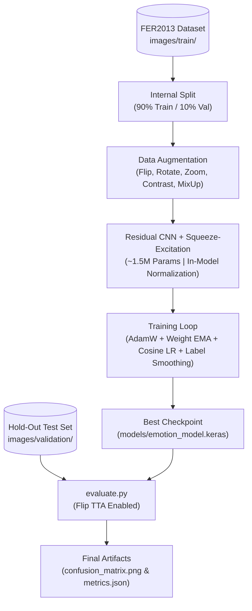
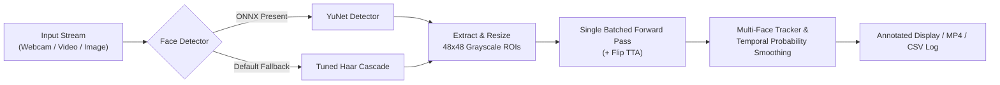

# 🎭 Real-Time Facial Emotion Detection (CNN, Keras 3)

[](https://www.python.org/)
[](https://keras.io/)
[](https://opencv.org/)
[](https://www.kaggle.com/datasets/jonathanoheix/face-expression-recognition-dataset)

A real-time facial expression recognition pipeline built with **Keras 3** and **OpenCV**, classifying faces across **7 emotion categories**: `Angry`, `Disgust`, `Fear`, `Happy`, `Neutral`, `Sad`, and `Surprise`.

---

## 📌 Table of Contents
- [System Architecture & Pipelines](#-system-architecture--pipelines)
- [Model & Accuracy Improvements](#-model--accuracy-improvements)
- [Dataset Structure](#-dataset-structure)
- [Installation & Setup](#-installation--setup)
- [Training](#-training)
- [Inference & Evaluation](#-inference--evaluation)
- [Interactive Controls](#-interactive-controls)
- [Engineering Refactoring & Bug Fixes](#-engineering-refactoring--bug-fixes)
- [Realistic Benchmarks (FER2013)](#-realistic-benchmarks-fer2013)

---

## 🔄 System Architecture & Pipelines

### 1. Training & Evaluation Pipeline
To prevent data leakage, `train/` is split internally (90% train / 10% internal validation) for model selection, while `validation/` is strictly isolated as a final hold-out test set.



### 2. Real-Time Multi-Face Inference Pipeline
Supports live webcams, video files, and static images with batched inference and temporal smoothing to eliminate label flickering.



---

## 🧠 Model & Accuracy Improvements

Compared to standard baseline CNNs (~4.5M parameters prone to overfitting at ~61% validation accuracy), this architecture is leaner, better regularized, and lighting-robust:

* **Compact Residual + Squeeze-Excitation (SE) Backbone (~1.5M params):** Channel attention recalibrates facial feature maps while cutting parameter count by ~66%.
* **In-Model Standardization:** Per-image pixel normalization lives inside the Keras computation graph, eliminating train/inference preprocessing mismatches.
* **Class Imbalance Handling:** Applies square-root balanced class weights to boost minority classes like `disgust` (~436 training samples) without destabilizing gradients.
* **Modern Training Recipe:**
  * **Optimizer:** `AdamW` with weight decay and Exponential Moving Average (`EMA`) weights.
  * **Scheduler:** Cosine learning rate decay with linear warm-up.
  * **Regularization:** Spatial augmentations (flip, rotation, shift, zoom, brightness/contrast), optional **MixUp**, and **Label Smoothing**.
* **Test-Time Augmentation (TTA):** Averages predictions across original and horizontally flipped face crops during evaluation and live inference.

---

## 📂 Dataset Structure

Download the **Face Expression Recognition Dataset (FER2013)** from Kaggle and organize it as follows:

```text
images/
├── train/
│   ├── angry/
│   ├── disgust/
│   ├── fear/
│   ├── happy/
│   ├── neutral/
│   ├── sad/
│   └── surprise/
└── validation/
    ├── angry/
    ├── disgust/
    ├── fear/
    ├── happy/
    ├── neutral/
    ├── sad/
    └── surprise/
```

---

## ⚙️ Installation & Setup

### 1. Install Dependencies
```bash
pip install -r requirements.txt
```

### 2. Optional: Enable YuNet Face Detector
By default, the app uses a tuned OpenCV Haar Cascade detector. For improved accuracy on angled or partially occluded faces, place `face_detection_yunet_2023mar.onnx` inside the `models/` directory—the pipeline will detect and use it automatically.

---

## 🏋️ Training

Run the training script with MixUp augmentation:

```bash
python train.py --data path/to/images --epochs 100 --mixup 0.2
```

### Generated Artifacts
* `models/emotion_model.keras` — Best model weights saved from the internal 10% split.
* `outputs/training_curves.png` — Loss and accuracy progression across epochs.
* `outputs/confusion_matrix.png` — Normalized confusion matrix across all 7 classes.
* `outputs/metrics.json` — Precision, recall, F1-score, and overall accuracy breakdown.

---

## 🚀 Inference & Evaluation

### Run Real-Time Inference (`app.py`)
```bash
# 1. Live webcam feed
python app.py

# 2. Process a video file, save annotated output, and log predictions to CSV
python app.py --source clip.mp4 --save out.mp4 --log detections.csv

# 3. Run inference on a single image
python app.py --source photo.jpg

# 4. Improve FPS on slower CPUs by running detection every N frames
python app.py --process-every 2
```

> **Legacy Fallback:** If `models/emotion_model.keras` is not found, `app.py` automatically falls back to `models/legacy_model.h5`.

### Run Hold-Out Evaluation & Unit Tests
```bash
# Evaluate on the held-out validation set
python evaluate.py --data path/to/images/validation

# Run unit tests (no TensorFlow installation required)
python -m unittest discover tests
```

---

## 🎮 Interactive Controls

While running `app.py` in webcam or video mode:

| Key | Action |
| :--- | :--- |
| `q` / `Esc` | Quit application |
| `Space` | Pause / resume playback |
| `s` | Save a screenshot of the current annotated frame |
| `h` | Toggle per-emotion probability bar overlay |
| `m` | Mirror / flip camera feed horizontally |

---

## 🛠️ Engineering Refactoring & Bug Fixes

| Area | Legacy Issue | Fix Implemented |
| :--- | :--- | :--- |
| **Normalization** | Trained on raw `[0, 255]` pixels while `main.py` divided by `255` | Moved normalization directly inside the Keras model layers |
| **Checkpointing** | Monitored deprecated `val_acc` metric (never saved best weights) | Updated to `val_accuracy` with Keras 3 `.keras` format |
| **API Compatibility** | Used removed `fit_generator`, `lr=`, and `keras.preprocessing.*` | Migrated cleanly to modern Keras 3 `model.fit()` & `tf.data` / layers |
| **Data Leakage** | Used `validation/` for early stopping *and* final accuracy reporting | Carved out a 10% split from `train/`; kept `validation/` strictly unseen |
| **Inference Speed** | Executed separate `model.predict()` calls per detected face | Consolidated all faces in a frame into a single batched forward pass |
| **Stability & Paths** | Hard-coded `C:\Users\...` paths and crashed on empty camera frames | Replaced with relative paths, safe frame guards, and proper empty-ROI checks |

---

## 📊 Realistic Benchmarks (FER2013)

FER2013 contains noisy crowd-sourced labels where **human inter-annotator agreement is ~65–72%**. A well-regularized CNN trained from scratch on FER2013 realistically achieves **high-60s to low-70s %** accuracy on the hold-out test set. Pushing significantly beyond ~73–75% requires cleaner relabeled datasets (**FER+**), larger datasets (**AffectNet**), or large pretrained vision backbones rather than deeper custom CNNs.
